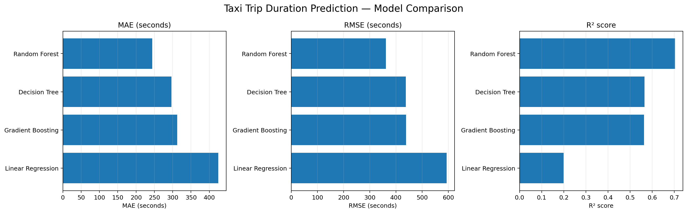
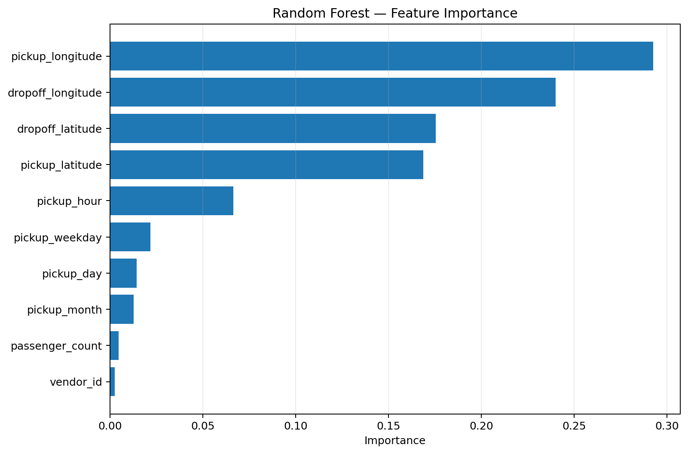

# Taxi Trip Duration Prediction

A machine-learning project that predicts taxi trip duration using trip,
location, passenger, and pickup-time information.

## Dataset

This project uses the [Kaggle NYC Taxi Trip Duration competition](https://www.kaggle.com/competitions/nyc-taxi-trip-duration/team).
The dataset contains pickup and drop-off locations, pickup time, passenger
count, vendor information, and the target trip duration.

## Apache Pig

Apache Pig is used as the data-preprocessing layer. The Pig scripts:

- clean invalid and missing records;
- filter unrealistic coordinates, passenger counts, and trip durations;
- prepare hourly trip statistics; and
- export a clean, machine-learning-ready dataset for Python.

This separates large-scale data preparation from model training and makes the
input data consistent and reproducible.

## Machine Learning

Python and scikit-learn are used to compare four regression algorithms:

- **Linear Regression:** A simple baseline that models trip duration as a
  weighted linear combination of the input features.
- **Decision Tree Regression:** Splits the data into feature-based regions and
  predicts a duration for each region. It can capture non-linear relationships
  but may overfit without appropriate constraints.
- **Random Forest Regression:** Combines predictions from many decision trees
  trained on different samples and feature subsets. This improves stability
  and usually reduces overfitting compared with a single tree.
- **Gradient Boosting Regression:** Builds trees sequentially, with each new
  tree correcting errors made by the previous trees. It can model complex
  patterns accurately but requires careful tuning.

Random Forest achieved the best reported results:

- **MAE:** 243.90 seconds
- **RMSE:** 361.69 seconds
- **R²:** 0.7032

## Visual Results

### Model Comparison

### Feature Importance

## Project Outputs

The dashboard images and model result tables are available in
[`docs/images/`](docs/images/) and [`outputs/ml/`](outputs/ml/).
